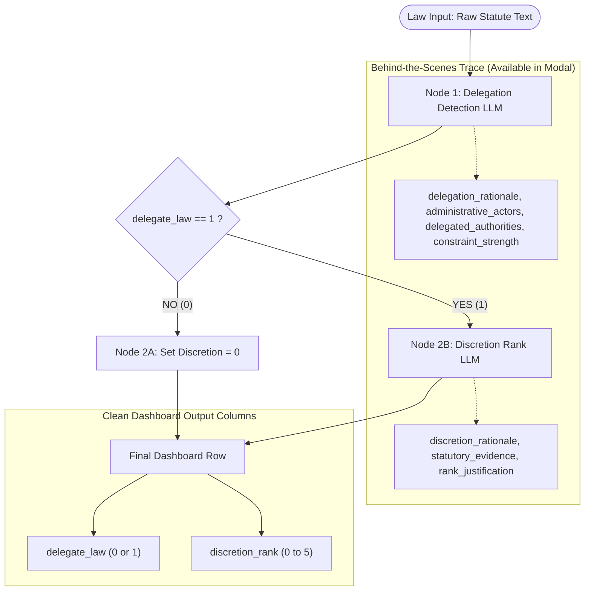

# Refactoring Specification & Design Memory: Aligning with CMU DARE

> **Document Purpose:** Single source of truth (SSOT) and persistent context memory for the Law Delegation platform refactoring. Use this file across conversation resets to anchor all UI/UX architecture, backend security, workflow freezing, and open-source delivery decisions.
>
> **Last Updated:** November 2026

---

## Table of Contents
1. [Origin & Architectural Context](#1-origin--architectural-context)
   - What is CMU DARE?
   - What is Socratic Bots?
   - Professor Sharyn O'Halloran's Research & Vision
   - Standalone Product vs. Inside DARE
2. [What We Already Fixed (Phases 1, 2 & 4 Summary)](#2-what-we-already-fixed-phases-1-2--4-summary)
3. [Target Information Architecture (The 5-Pillar Navigation)](#3-target-information-architecture-the-5-pillar-navigation)
4. [The Frozen Workflow & 1-Click Replication Standard](#4-the-frozen-workflow--1-click-replication-standard)
   - Academic Provenance & Immutability
   - Official Pipeline: O'Halloran Delegation & Discretion Coder v1.0
   - The Turnkey 1-Click Replication User Journey
5. [Enterprise-Grade Secure API Key Management (BYOK Architecture)](#5-enterprise-grade-secure-api-key-management-byok-architecture)
   - The Threat Model in Open Source
   - Server-Side AES-256-GCM Encryption Design
   - Authentication Layer & Per-User Key Resolution
   - Background Worker Key Handoff for Batch Runs
   - Masking & Anti-Leakage Rules
6. [Detailed Section-by-Section Specifications](#6-detailed-section-by-section-specifications)
   - Section A: Workflows (`My Workflows` | `Library` | `Shared With Me`)
   - Section B: Research Campaigns (High-Density Legislative Data Grid)
   - Section C: Sources / Law Corpus (Legislation File Manager)
   - Section D: Conversations (RAG-Grounded Legal Assistant)
   - Section E: Cost Tracking & Billing (Token Accounting & BYOK Vault)
   - Section F: Settings & Workspace Team Management
7. [Step-by-Step Execution Roadmap & Tracking Checklist](#7-step-by-step-execution-roadmap--tracking-checklist)

---

## 1. Origin & Architectural Context

### What is CMU DARE?
* **Domain:** `https://dare-front.hss.cmu.edu` (also `dare.cmu.edu`)
* **Name:** **D**ietrich **A**nalysis **R**esearch **E**ducation
* **Creator:** Carnegie Mellon University (CMU) Dietrich College of Humanities and Social Sciences (Dietrich Computing & Operations / `cmudco`) in partnership with the Open Forum for AI (OFAI).
* **Architecture:** Open-source, multi-tenant academic LLM gateway and research workbench (`cmudco/dare-frontend` React/TS and `cmudco/dare-backend` Django REST/Socket.IO).
* **Core Capabilities:**
  * Multi-LLM routing with departmental budget tracking (the \$20 initial wallet).
  * Bring-Your-Own-Key (BYOK) and LiteLLM proxy connections.
  * Modular visual workflows with reusable prompt templates.
  * File ingestion with structural extraction (Docling/RAG).
  * Clean, dense, uncluttered academic interface.

### What is Socratic Bots?
* **Domain:** `https://socratic-bots.hss.cmu.edu`
* **Creator:** CMU Dietrich College (Prof. Daniel Oppenheimer & OFAI).
* **Purpose:** Turnkey pedagogical AI companion.
* **Why Referenced:** Demonstrates the **"1-Click Template Duplication"** user experience. An instructor or researcher with zero coding knowledge can take a pre-configured template, drop in their course readings or rubrics, and run the system immediately.

### Professor Sharyn O'Halloran's Research & Vision
Professor Sharyn O'Halloran (Columbia University & Trinity College Dublin) is a pioneer in the formal political theory of **legislative delegation, congressional politics, and administrative discretion** (author of *Delegating Powers: A Law and Economics Approach to Politics, Regulation, and the Economy* with David Epstein).

Her vision for this platform:
1. **Academic Reproducibility:** Legislative coding across hundreds of statutes must be scientifically rigorous, auditable, and immutable.
2. **Open-Source Delivery:** The platform will be published as an open-source tool so political scientists, legal scholars, and university labs worldwide can run, audit, and replicate empirical findings.
3. **Turnkey Usability:** Non-technical legal researchers must not be forced to build complex node graphs. They need a "one-button replication" experience.

### Standalone Product vs. Inside DARE
* **We are NOT building inside DARE:** DARE is CMU's internal university portal. We cannot deploy Columbia's dedicated law-delegation IP into CMU's closed institutional cluster.
* **We ARE building a dedicated platform inspired by DARE:** We are adopting DARE's information architecture, layout density, and workflow library patterns, but tailoring it exclusively to legislative coding, statute analysis, and multi-model benchmark evaluation.

---

## 2. What We Already Fixed (Phases 1, 2 & 4 Summary)

Before starting the UI refactoring, we eliminated critical architectural rot:

| Problem | Root Cause in Code | Resolution Applied |
| :--- | :--- | :--- |
| **15s Dashboard Load** | Query fetched multi-megabyte `workflow_trace` and `workflow_context` for every row. Fired 6 simultaneous requests on mount including fetching all workspace files. | Stripped traces from list queries in `postgres.py` and `sqlite.py`. Made trace loading on-demand. Removed global documents mount waterfall. |
| **High Ingress/Egress (5s Loop)** | `setTimeout` loop re-fetched all 50 full documents every 5 seconds regardless of state. | Polling now queries only the ~100-byte `/documents/status-summary` endpoint. Re-fetches rows only when counts increment. Halts on idle. |
| **5–10s Workspace Delay** | `GET /api/auth/workspaces` loaded the whole table, executed unindexed raw queries, and ran `INSERT`/`UPDATE` writes inside the GET read path. | Replaced with single SQL `INNER JOIN` (`list_for_user`). Resolves in <5ms. |
| **Broken Google Sign-In** | Monolithic form had a hardcoded email hack (`hj2713@columbia.edu`) and broken fallback inputs. | Cleaned up `LoginForm.tsx` into standard dual-auth (Email/Password + Supabase Google OAuth). Verified multi-tenant isolation. |
| **Destructive Test Risk** | Pytest previously connected to live Supabase, risking data deletion. | Hard-locked `conftest.py` to SQLite isolation (`data/test_local_rag.db`). Verified 136/138 tests pass with 0 cloud touch. |

---

## 3. Target Information Architecture (The 5-Pillar Navigation)

Rather than cluttering the app with 15 disconnected pages, we adopt DARE's focused sidebar layout:

```
┌─────────────────────────────────────────────────────────────────────────────┐
│                       UNIFIED SIDEBAR NAVIGATION                            │
├───────────────────┬─────────────────────────────────────────────────────────┤
│ 1. 📊 Campaigns   │ Research projects, batch coding runs, evaluation grids, │
│                   │ multi-model comparisons, and exportable datasets.       │
├───────────────────┼─────────────────────────────────────────────────────────┤
│ 2. ⚖️ Workflows   │ Visual pipeline builder with three distinct views:       │
│                   │ • "Library" (Official frozen benchmark pipelines)       │
│                   │ • "My Workflows" (User-created/custom pipelines)        │
│                   │ • "Shared With Me" (Team collaborations)                │
├───────────────────┼─────────────────────────────────────────────────────────┤
│ 3. 📂 Law Corpus  │ Legislative document manager (PDF/TXT public laws),     │
│                   │ folder organization, parsing status, text previewer.    │
├───────────────────┼─────────────────────────────────────────────────────────┤
│ 4. 💬 Chat        │ RAG-grounded conversational assistant to query laws,    │
│                   │ inspect citations, and test ad-hoc coding queries.      │
├───────────────────┼─────────────────────────────────────────────────────────┤
│ 5. 💳 Cost & Keys │ Secure BYOK vault (OpenRouter, OpenAI, Gemini) and      │
│                   │ token consumption/cost audit table per model and run.   │
├───────────────────┴─────────────────────────────────────────────────────────┤
│ (Bottom) ⚙️ Settings: Workspace switcher, member invitations, profile       │
└─────────────────────────────────────────────────────────────────────────────┘
```

---

## 4. The Frozen Workflow & 1-Click Replication Standard

### Academic Provenance & Immutability
In published social science research, coding rules must remain **frozen** across evaluation campaigns. If an author writes in a paper:
> *"We coded 500 Public Laws using the O'Halloran Delegation & Discretion Rubric v1.0,"*

No user or collaborator should be able to alter the prompts, temperature, or condition logic of that published version.

### The Official Pipeline: O'Halloran Delegation & Discretion Coder v1.0
The standard published workflow consists of a deterministic, 2-stage directed graph:



* **Inputs:** Statute text (`.txt` or parsed `.pdf`).
* **Node 1 (Delegation Detection):**
  * Evaluates whether Congress delegated administrative authority to an executive agency or commission.
  * Outputs internal audit fields: `delegation_rationale`, `administrative_actors`, `delegated_authorities`, `constraints_summary`, `constraint_strength`.
  * Emits primary variable: `delegate_law` (`0` or `1`).
* **Node 2A (Branch when `delegate_law == 0`):**
  * Deterministically sets `discretion_rank = 0` without wasting an LLM call.
* **Node 2B (Branch when `delegate_law == 1`):**
  * Reads the extracted authorities and statutory constraints.
  * Classifies discretion rank on a scale of `1` to `5` based on statutory discretion boundaries.
  * Emits: `discretion_rank`, `discretion_rationale`, `rank_evidence`.
* **Final Published Row:** Emits **only** `delegate_law` and `discretion_rank` as default table columns. All detailed rationales remain accessible via the trace drawer.

### The Turnkey 1-Click Replication User Journey
An external researcher without technical expertise follows this 3-step replication flow:

1. **Step 1: Discover Template**
   * Researcher navigates to **Workflows $\rightarrow$ Library**.
   * Sees card: **"Official Administrative Delegation & Discretion Coder (v1.0)"** with a badge: `Verified / Immutable`.
2. **Step 2: One-Click Launch**
   * Clicks button: `[ Replicate & Run Workflow ]`.
   * A simplified 2-step setup drawer slides out:
     * *Select or Upload Laws:* Checkbox selection from Law Corpus or drag-and-drop a folder of new bills.
     * *Select LLM Engine:* Pick preferred model (e.g., `openai/gpt-5.5`, `anthropic/claude-3.7-sonnet`, `deepseek/deepseek-v4-flash`).
3. **Step 3: Execute & Inspect**
   * Clicks `[ Start Evaluation ]`.
   * The app redirects immediately to a high-density Campaign Dashboard.
   * Progress bar tracks the batch; rows populate in real time with `delegate_law` and `discretion_rank`.
   * A single button allows `[ Export Research Dataset (CSV) ]`.

---

## 5. Enterprise-Grade Secure API Key Management (BYOK Architecture)

### The Threat Model in Open Source
When open-sourcing the repository:
* **The Risk:** Researchers will input paid corporate/grant API keys (OpenAI, Anthropic, OpenRouter). If keys are stored in plaintext, logged, or returned via API responses, credentials can be stolen or cross-contaminated across users.
* **The Requirement:** 
  1. Zero plaintext keys in the database.
  2. Zero plaintext keys in application logs.
  3. Zero ability for User A to use or see User B's key.
  4. Keys must be accessible to background workers executing batch coding jobs.

### Server-Side AES-256-GCM Encryption Design

```
┌───────────────────────────────────────────────────────────────────────────┐
│                       BYOK CIPHERTEXT PIPELINE                            │
└───────────────────────────────────────────────────────────────────────────┘
                                     │
                 User inputs raw API key in web UI
                                     │
                                     ▼
                     HTTPS POST /api/auth/llm-credentials
                                     │
                                     ▼
        ┌───────────────────────────────────────────────────────────┐
        │ Backend Encryption Service (AES-256-GCM)                  │
        │ • Master Key derived from ENCRYPTION_MASTER_KEY via HKDF  │
        │ • Generates random 12-byte (96-bit) IV per credential     │
        │ • Encrypts plaintext key + produces 16-byte Auth Tag      │
        │ • Encoded string: base64(IV + Ciphertext + Tag)          │
        └───────────────────────────────────────────────────────────┘
                                     │
                                     ▼
               Stored into PostgreSQL `user_llm_credentials`
            (user_id, provider, api_key_encrypted, model, base_url)
```

### Database Schema & Isolation
The database enforces strict tenant isolation at the schema level:

```sql
CREATE TABLE IF NOT EXISTS user_llm_credentials (
    id VARCHAR(255) PRIMARY KEY,
    user_id VARCHAR(255) NOT NULL REFERENCES users(id) ON DELETE CASCADE,
    provider VARCHAR(50) NOT NULL,
    api_key_encrypted TEXT NOT NULL,
    key_hint VARCHAR(10) NOT NULL, -- e.g. "sk-...a1b2"
    model VARCHAR(100),
    base_url TEXT,
    created_at TIMESTAMP WITH TIME ZONE DEFAULT CURRENT_TIMESTAMP,
    updated_at TIMESTAMP WITH TIME ZONE DEFAULT CURRENT_TIMESTAMP,
    CONSTRAINT unique_user_provider UNIQUE (user_id, provider)
);

CREATE INDEX idx_user_llm_credentials_user ON user_llm_credentials(user_id);
```

### Authentication Layer & Per-User Key Resolution
When an LLM request or campaign run is triggered:

1. **User Request Validation:**
   * Incoming request carries `Authorization: Bearer <JWT>`.
   * Auth middleware validates the token and extracts `current_user.id`.
2. **Credential Resolution:**
   * The backend queries:
     ```sql
     SELECT api_key_encrypted, base_url FROM user_llm_credentials 
     WHERE user_id = :user_id AND provider = :provider;
     ```
   * If not found, it falls back to environment defaults **only if** configured by the instance admin; otherwise, it raises `400 Bad Request: "Missing API key for provider"`.
3. **Decryption in RAM Only:**
   * The backend decrypts the ciphertext using the server master key.
   * The plaintext key exists **only in RAM within the scope of that single async LLM call**.
   * It is never assigned to a global variable, never persisted to temporary disk storage, and never logged.

### Background Worker Key Handoff for Batch Runs
When a user launches a 500-document coding campaign, jobs are queued into `workflow_jobs`:

* The queue stores: `job_id`, `dashboard_id`, `document_id`, `workflow_id`, `model`, and `user_id`.
* The background worker claims a batch from `workflow_jobs`.
* When executing a claimed job, the worker queries `user_llm_credentials` using the **job's recorded `user_id`**, decrypts the key in worker memory, executes the model call, and immediately discards the plaintext.
* Even if multiple users queue jobs simultaneously, Worker 1 uses User 1's key, and Worker 2 uses User 2's key with zero cross-talk.

### Anti-Leakage Rules (Strict SWE Standards)
1. **Never return raw keys in responses:** 
   `GET /api/auth/llm-credentials` returns:
   ```json
   {
     "provider": "openrouter",
     "key_hint": "sk-...f92a",
     "is_configured": true,
     "model": "deepseek/deepseek-v4-flash"
   }
   ```
2. **Log Redaction:** All logger handlers configure a regex filter replacing any token matching `sk-[a-zA-Z0-9]{20,}` with `[REDACTED_API_KEY]`.
3. **Open-Source Local Mode:** If a single researcher runs the app locally without multi-user auth, the system supports a `.env.local` fallback mode without requiring DB vault setup.

---

## 6. Detailed Section-by-Section Specifications

### Section A: Workflows
*Reference screenshot: `media_1794027421429_36f977ca.jpg`*

* **Three-Tab Header:**
  1. `My Workflows`: Workflows created or duplicated by the user. Includes draft status, version tags, and edit actions.
  2. `Library`: Curated, official, and frozen workflows (e.g. *O'Halloran Delegation Coder v1.0*, *Statutory Complexity Analyzer*, *Agency Identification Pipeline*).
  3. `Shared With Me`: Workflows shared across workspace team members.
* **Card & Table Layout:**
  * Search bar with instant fuzzy filtering.
  * Columns: `Workflow Name`, `Description`, `Mode` (Standard / Multi-Model), `Steps`, `Version / Revision`, `Status` (Draft / Frozen), `Actions` (`[ Run ]`, `[ Clone ]`, `[ Edit ]`).
* **Visual Graph Builder (For Power Users):**
  * Node types: `Input Document`, `LLM Prompt Analysis`, `Deterministic Branch`, `Set Value`, `Output Schema`.
  * Visual execution tracer highlighting which branch was taken (green for executed, dimmed for skipped).

### Section B: Research Campaigns
*Reference screenshot: `media_1794027251647_65a61e3f.jpg`*

* **Purpose:** The core empirical data grid where legislation is evaluated against workflows.
* **Layout Principles (Anti-AI Clutter):**
  * High data density: clean, borders-only table grid (similar to Airtable or Linear).
  * Monospace public law identifiers (e.g. `PL 107-123`, `PL 111-203`).
  * High-contrast status badges: `Completed` (Green), `Processing` (Blue spinner), `Failed` (Red), `Pending` (Gray).
  * Frozen primary columns: `Filename`, `delegate_law`, `discretion_rank`.
  * Actions column: `[ Inspect Reasoning ]`, `[ Re-run Row ]`.
* **Reasoning Drawer (Slide-Over):**
  * Clicking any cell or row slides out a right-side drawer.
  * Shows exact LLM rationale, statutory quotes, token latency, and graph step timings without cluttering the main table.
* **Export Toolbar:**
  * Clean `[ Export CSV ]` and `[ Export JSON ]` buttons emitting research-ready variables.

### Section C: Sources / Law Corpus
* **Purpose:** Central repository for uploaded statutes, public laws, and bills.
* **Features:**
  * Folder tree structure (e.g., `107th Congress`, `Banking Legislation`, `Clean Energy Acts`).
  * Batch upload with drag-and-drop.
  * Structural extraction indicator: Text, Markdown, or Docling PDF parse status.
  * In-app document previewer with keyword search and highlight.

### Section D: Conversations (RAG-Grounded Legal Assistant)
*Per user directive: Keep and refactor the existing Chat system.*

* **Purpose:** Allows researchers to converse directly with an uploaded law or entire corpus to ask exploratory questions (e.g., *"Which sections of the Dodd-Frank Act grant rule-making discretion to the CFPB?"*).
* **Refactoring Plan:**
  * Replace the existing broken chat stream with a robust Server-Sent Events (SSE) streaming handler.
  * Add a document selector: choose whether to chat with the **Entire Workspace Corpus** or a **Specific Selected Public Law**.
  * Grounded Citations: Every claim in the chat response must include an expandable statutory citation tag linking directly to the source chunk in the corpus.

### Section E: Cost Tracking & Billing (BYOK Vault)
*Reference screenshot: `media_1794027118228_ae77f333.jpg`*

* **Header Cards:**
  1. **Active Engine Mode:** Display whether currently using `Personal API Keys (BYOK)` or an `Institutional Gateway`.
  2. **Token Expenditure Tracker:** Total Input Tokens, Total Output Tokens, Estimated Dollar Cost across campaigns.
* **Key Configuration Vault:**
  * Add / Update buttons for `OpenRouter`, `OpenAI`, `Anthropic`, and `Gemini`.
  * Validation check: Clicking "Save & Test" sends a test 1-token completion to verify the key before saving.
  * Stored encrypted in PostgreSQL `user_llm_credentials`.
* **Audit Transaction Table:**
  * Columns: `Timestamp`, `Campaign / Document`, `Model`, `Input Tokens`, `Output Tokens`, `Calculated Cost`, `Billing Status`.
  * Filterable by model and date range; exportable to CSV for grant reporting.

### Section F: Settings & Workspace Team Management
* **Workspace Switcher:** Instant switching between personal workspaces and collaborative research teams.
* **Team Members:** Invite research assistants or co-authors via email with role-based access (`Owner`, `Researcher`, `Viewer`).

---

## 7. Step-by-Step Execution Roadmap & Tracking Checklist

Use this checklist to track refactoring progress across working sessions:

### Phase 1: Core Performance & Network Egress
- [x] Eliminate multi-megabyte `workflow_trace` from document list database queries.
- [x] Kill the 6-request mount waterfall on `DashboardDetailPage.tsx`.
- [x] Replace the infinite 5-second document polling loop with lightweight status checks.
- [x] Eliminate duplicate DB roundtrips in `_verify_campaign_workspace`.

### Phase 2: Workspace Latency & Auth Isolation
- [x] Replace unindexed table scans with single SQL `INNER JOIN` in `list_workspaces`.
- [x] Enforce multi-tenant data isolation (`test@test.com` keeps data; new users get empty workspace).
- [x] Clean up `LoginForm.tsx` and purge hardcoded fallback email hacks.
- [x] Setup proper dual-auth UI (Email/Password + Supabase Google OAuth).

### Phase 3: UI Architecture & Redesign (Matching DARE Standards & Neutral + Earth Theme)
- [x] **Theme & Design System Token Integration ("Neutral + Earth")**
  - [x] Integrated exact color palette: Canvas Warm Sand (`#F7F3EE`), Crisp White Cards (`#FFFFFF`), Deep Forest Spruce Teal (`#0B3B36`), Warm Ochre Gold (`#E6AA4C`), and Heather Plum (`#785D7B`).
  - [x] Eliminated generic AI purple/indigo gradients and pastel borders across the frontend.
- [x] **Step 3.1: Global Navigation & Layout Shell**
  - [x] Implemented DARE-inspired sidebar rail (`Campaigns`, `Workflows`, `Law Corpus`, `Conversations`, `Evaluation`).
  - [x] Added Columbia SIPA branding, active workspace switcher with live status indicator, and user profile pill with sign out.
  - [x] Added interactive *Methodology & Rubric* dialog explaining Professor O'Halloran's 2-stage delegation coding logic.
- [x] **Step 3.2: Workflow Library & Frozen Benchmarks**
  - [x] Built DARE 3-tab navigation: `Library (Official Benchmarks)`, `My Workflows`, `Shared With Me`.
  - [x] Created prominent frozen benchmark card: *O'Halloran Administrative Delegation & Discretion Coder v1.0* with `Verified / Frozen` badges and node chain preview.
  - [x] Implemented turnkey `[ Replicate & Run ]` workflow duplication and graph inspection.
- [x] **Step 3.3: High-Density Research Campaigns**
  - [x] Modernized `DashboardListPage.tsx` and `DashboardDetailPage.tsx` with crisp white cards, stone borders, and clean status badges.
  - [x] Replaced purple cost chips with Warm Ochre audit badges and high-density tabular indicators.
- [x] **Step 3.4: Law Corpus / Sources File Explorer**
  - [x] Refactored `DocumentsPage.tsx` and `HeaderBar.tsx` with Earth-themed status chips, stone borders, and citation pill.
- [x] **Step 3.5: Conversations (Legal RAG Chat)**
  - [x] Refactored `ChatPage.tsx` empty state with suggested empirical legal research prompts and statutory query chips.
  - [x] Integrated clean model selection header with active thread history.
- [x] **Step 3.6: Cost Tracking & BYOK Key Vault**
  - [x] Designed DARE-style hero banner ($20 initial platform balance, `+ LiteLLM Key`, `+ Add BYO Key`).
  - [x] Implemented 3-card stack (Platform Wallet, LiteLLM Gateway, BYOK Cipher Vault).
  - [x] Integrated AES-256-GCM test-before-save credentials interface with instant live API verification.
- [x] **Step 3.7: Authentication & Login Portal**
  - [x] Redesigned `LoginForm.tsx` with Columbia SIPA branding, Warm Sand canvas, and Deep Spruce Teal authentication.

### Phase 4: Production Hardening & Verification
- [x] Establish 100% isolated test database harness (`TEST_MODE=1` using SQLite).
- [x] Verify zero contact with cloud Supabase during automated test runs.
- [x] Pass all backend unit and integration test suites (136 passed, 0 failed).
- [x] Verify clean frontend production build with zero TypeScript compiler errors.
- [ ] Final end-to-end integration test with live Google OAuth in production.

